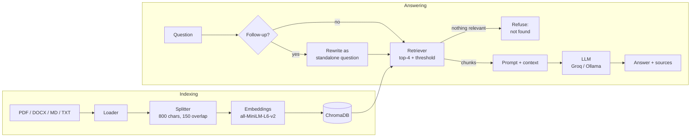

# Enterprise Knowledge Assistant

A question-answering assistant for company documents, built with **Retrieval-Augmented Generation (RAG)**. Employees upload documents (HR policy, IT security policy, onboarding guide...) and ask questions in plain English. The assistant finds the relevant passages, answers using only those passages, shows which document and page each answer came from, and says it doesn't know when the documents don't cover the question.

**Stack:** Python, LangChain, sentence-transformer embeddings, ChromaDB, Groq / Ollama (Llama 3), Streamlit, FastAPI.

> Screenshot: add `docs/screenshot.png` after your first run and show it here with ``.

## Features

- Ingests **PDF, DOCX, TXT and Markdown** files; re-ingesting a file replaces its old chunks (no duplicates).
- **Cited answers**: every answer lists the source file, page and a snippet.
- **Refuses instead of guessing**: if nothing relevant is found, it answers "I couldn't find this in the company documents." without calling the LLM.
- **Follow-up questions** ("And for contractors?") work through question rewriting.
- **Streamlit chat UI**, a **terminal chat** (`cli.py`) and a **REST API** (`api.py`).
- A **30-question evaluation** that measures retrieval hit rate, MRR, answer accuracy, refusal accuracy and latency.

## How it works



## Setup

You need Python 3.11 or newer (LangChain 1.x and Streamlit require it).

```bash
python -m venv .venv
# Windows:  .venv\Scripts\activate        macOS/Linux:  source .venv/bin/activate
pip install -r requirements-dev.txt
cp .env.example .env        # Windows: copy .env.example .env
```

Open `.env` and set `GROQ_API_KEY` (free key from https://console.groq.com). To run fully offline instead, install [Ollama](https://ollama.com), run `ollama pull llama3.2`, and set `LLM_PROVIDER=ollama`.

The first time you ingest, the embedding model (about 90 MB) is downloaded from Hugging Face.

## Run it

```bash
python -m src.ingest data/sample_docs --reset   # index the 8 sample documents
streamlit run app.py                            # web UI
python cli.py                                   # or: terminal chat
uvicorn api:app --reload                        # or: REST API, docs at http://127.0.0.1:8000/docs
pytest                                          # tests (no internet or API key needed)
```

REST example:

```bash
curl -X POST http://127.0.0.1:8000/ask -H "Content-Type: application/json" \
     -d '{"question": "How many sick leave days do I get?"}'
```

The sample documents belong to a made-up company, "Nimbus Technologies". Regenerate them with `python data/make_sample_docs.py`.

## Evaluation

```bash
python -m eval.evaluate --no-llm --sweep        # retrieval only; shows how the threshold behaves
python -m eval.evaluate --chunk-sizes 500 800 --search-types similarity mmr --delay 2 --write
```

The second command needs a Groq key and writes `eval/results.md`. Results below are filled in from that file.

| Configuration | Hit Rate@4 | MRR | Answer accuracy | Refusal accuracy | Avg latency |
|---|---|---|---|---|---|
| _not run yet_ | | | | | |

The question set has 22 answerable questions, 4 follow-ups and 4 unanswerable ones. Answer accuracy is judged by an LLM, so check the per-question table in `results.md` by hand before quoting it.

## Project structure

```
app.py, cli.py, api.py     three ways to talk to the assistant
config.py                  all settings in one place
src/                       loader, splitter, embeddings, vectorstore, retriever, llm, prompts, rag_chain, ingest
eval/                      test questions and the evaluation script
data/                      sample documents and the script that generates them
tests/                     pytest tests
```

See `NOTES.md` for a plain-language walkthrough of every file.

## Deploy (Hugging Face Spaces)

1. Create a new Space, choose the **Docker** SDK, and push this project to it.
2. In the Space settings add a secret named `GROQ_API_KEY`.
3. The `Dockerfile` serves Streamlit on port 7860 and indexes the sample documents at build time.

Locally: `docker build -t knowledge-assistant .` then `docker run -p 7860:7860 -e GROQ_API_KEY=... knowledge-assistant`.

## Design decisions

- **Chunks of 800 characters with 150 overlap.** Big enough to hold a whole policy clause, small enough that retrieval stays precise; the overlap keeps sentences that cross a boundary. The evaluation compares 500 and 800.
- **`all-MiniLM-L6-v2` embeddings.** Free, runs on CPU, small (384 dimensions) and good enough for short policy text. A bigger model would be more accurate but slower.
- **ChromaDB on disk.** No server to run and it stores metadata (file, page, chunk id) next to the vectors.
- **Relevance threshold.** If even the best chunk scores below the threshold, the assistant refuses without calling the LLM. This stops guessing on off-topic questions and saves cost. The right value is found with `--sweep`, not guessed.
- **Plain LCEL code, not the old `RetrievalQA` classes.** `prompt | llm | parser` plus ordinary functions is easier to read, test and explain.
- **Temperature 0** for consistent, fact-sticking answers.

## Limitations and future work

- Questions whose topic is covered by the documents but whose exact answer is missing (for example "what is the bonus?") score high on similarity. Only the LLM's own "not found" reply catches them, which is not perfectly reliable.
- No OCR: scanned PDFs without text are not readable.
- All users share one knowledge base; there is no per-document access control.
- Search is vector-only. Hybrid keyword + vector search and a re-ranker would help with exact terms such as policy codes.
- Uploaded documents are lost on Hugging Face Spaces when the container restarts.
